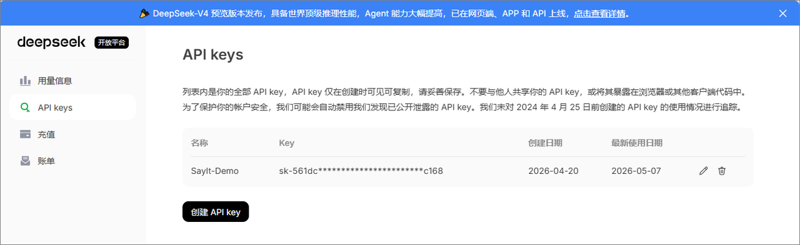
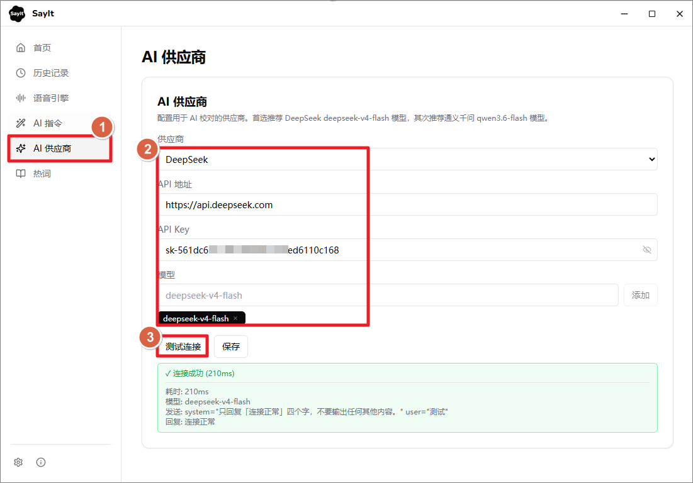
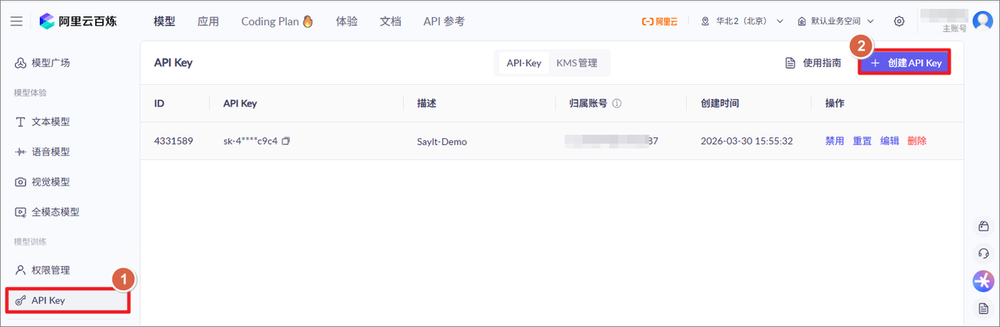

# SayIt AI 润色供应商配置

SayIt 有两个核心功能：将语言转录为文本（ASR）以及利用 AI 对文本进行润色。ASR 部分可以参考[SayIt 语音识别配置](https://my.feishu.cn/wiki/V4vLw2UfDiWcATkK2dyckhvynzc)。

AI 润色功能可以去除口癖词（嗯、啊、那个）、修正语音识别错误、翻译、自动分段排版等，都可以通过 Prompt 自定义控制。

SayIt 已对接国内常用的 AI 服务商（通义千问、DeepSeek、豆包等），同时支持 OpenAI 兼容格式，可以接入其他供应商或第三方中转服务商。

## 1. 推荐方案

AI 润色模型推荐使用 **deepseek-flash** 质量好、价格低、速度可接受。

如果对延迟极度敏感（需要 <500ms），可以用通义千问 qwen3.6-flash，速度最快但准确度稍微差点。

| 供应商　　　 | 模型　　　　　　　| 短文本 | 长文本（~200字） | 输入价格　　　　 | 输出价格　　　　　|
| --------------| -------------------| --------| ------------------| ------------------| -------------------|
| **DeepSeek** | deepseek-flash　　| 803ms　| 2089ms　　　　　 | 1~2 元/百万Token | 4~8 元/百万Token　|
| 通义千问　　 | qwen3.6-flash　　 | 393ms　| 1308ms　　　　　 | 1.8 元/百万Token | 10.8 元/百万Token |

DeepSeek 分空闲、高峰两档价格，高峰是北京时间工作日 9:00-12:00 和 14:00-18:00，其余时段半价；表里输入价格按未命中缓存算。以 [DeepSeek 官网价格页](https://api-docs.deepseek.com/zh-cn/quick_start/pricing) 为准。

## 2. 配置指南

AI 供应商建议直接使用官方 API。第三方中转站延迟普遍更高。

### DeepSeek（推荐）

- API 地址：`https://api.deepseek.com`
- 模型：`deepseek-flash`（旧名 `deepseek-v4-flash`、`deepseek-chat` 目前还能调，只是 DeepSeek 暂时转发到新模型；SayIt 启动时会把已有配置改成新名字）
- 获取 API Key：[platform.deepseek.com](https://platform.deepseek.com/api_keys)

### 通义千问

- API 地址：`https://dashscope.aliyuncs.com/compatible-mode`
- 模型：`qwen3.6-flash`
- 获取 API Key：[百炼平台](https://bailian.console.aliyun.com/?spm=a2c4g.11186623.0.0.60905ec6iyaRqr&tab=model#/api-key)

## 3. 补充说明

**关于思考模式**

很多模型默认开启思考（thinking / reasoning），延迟会飙升到 2~7 秒，而语音输入要的是越快出字越好，润色这种短文本任务并不需要模型先想一轮。

SayIt 会自动关闭思考，无需用户配置：请求里会带上各家格式的关闭参数，端点认哪个就哪个生效；少数不接受这些参数的端点（如 OpenAI 官方、Azure OpenAI）会自动跳过，不影响使用。上表中的延迟数据是关闭思考后的结果。

**关于豆包 AI**

目前豆包的语音识别（ASR）是目前中文场景下最好的，SayIt 推荐使用豆包 ASR。但豆包的 AI 文本模型延迟极不稳定，不适合润色场景。建议 语音识别（ASR）用豆包，AI 润色用 DeepSeek。

**质量对比**

DeepSeek 和通义千问都能正确去口癖、识别列表结构、纠正专有名词大小写（DeepSeek、ChatGPT、OpenAI 等）。DeepSeek Flash 在专有名词纠正和格式化方面更稳定，输出更简洁。